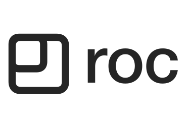
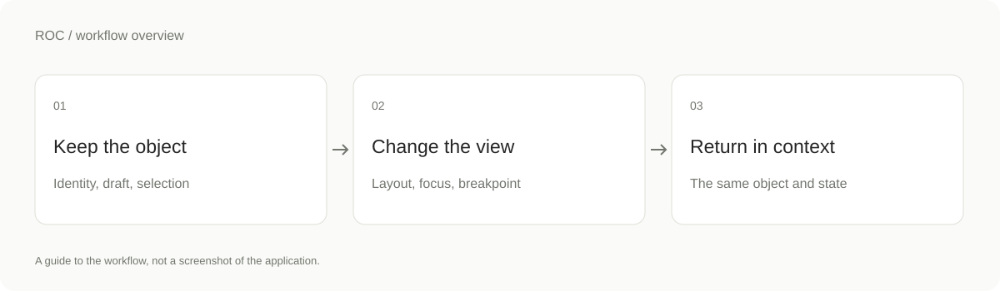

<h1 align="center">
  <picture>
    <source media="(prefers-color-scheme: dark)" srcset=".github/brand/lockup-dark.svg" />
    
  </picture>
</h1>

<p align="center"><b>The same object, through every change.</b></p>

<p align="center"><a href="https://songhaifan.github.io/roc-ui/">Design space</a> · <a href="https://songhaifan.github.io/roc-ui/skill.html">Install the skill</a> · <a href="skills/responsive-object-continuity/SKILL.md">Principles</a> · <a href="CONSTITUTION.md">Project contract</a> · <a href="README.zh-CN.md">中文</a></p>

<picture>
  <source media="(prefers-color-scheme: dark)" srcset=".github/brand/overview-dark.svg" />
  
</picture>

ROC brings an agent skill and an interactive design space into one project. Explore interfaces that retain the object, its state and its context through changes in layout, focus and viewport.

## Method and practice

| Part | Purpose | Source |
| --- | --- | --- |
| ROC Skill | Cross-framework principles, diagnostic workflow and source-backed cases for agents | [skills/responsive-object-continuity/](skills/responsive-object-continuity/) |
| Design space | Operable cases with shared visual and interaction standards | [src/](src/) |
| Reusable source | Components and registry payloads for bringing cases into another project | [registry/roc/](registry/roc/) |

The same repo owns the principles and their implementations. A case can evolve alongside the behavior it describes. The skill remains independently installable; reading it does not require React or the gallery's npm dependencies.

ROC uses existing libraries where they serve the experience. Base UI for interaction, Animate UI for motion, and ROC for visuals, defaults and composition is a useful division of responsibilities. The [constitution](CONSTITUTION.md) records the product and architecture choices.

## Install the skill

Download the standalone ZIP from the [skill page](https://songhaifan.github.io/roc-ui/skill.html), extract it and place the `responsive-object-continuity` folder in your agent's supported skill directory.

For a local checkout, link directly to the canonical source:

```sh
npm run skill:link
# Default destination: ~/.agents/skills/responsive-object-continuity

# Or choose a destination supported by your agent:
npm run skill:link -- /path/to/agent/skills/responsive-object-continuity
```

The command uses Node's built-in modules and leaves an existing unrelated destination untouched. A linked skill always reads the source in this checkout. Other hosts can copy `skills/responsive-object-continuity/` directly.

Ask your agent:

> Use $responsive-object-continuity to make this card expand into its reader while preserving the editor, selection and return position. Verify opening, closing after scrolling, and interruption on desktop and mobile.

Start at [SKILL.md](skills/responsive-object-continuity/SKILL.md), then read the relevant cases. The skill covers retained objects and state, safe areas, composition, navigation, drag, linked projections, material behavior and return handoffs. Source review, historical tests and current visual acceptance remain distinct evidence.

## Explore the design space

The gallery is one continuous progression: **Design System → Primitives → Interfaces**. Appearance controls update the live cases. Component detail supports focused inspection at desktop, tablet, phone and intermediate widths. Returning to the overview retains the previews and their state.

The cases include foundation controls, reading surfaces, collections, image inspection, audio, contextual editing and source trays. The gallery imports the same files it distributes; example data and gallery controls stay separate from reusable source.

[Design tokens and boundaries](notes/design-system.md) · [React contracts](notes/react-design-system.md) · [Catalog coverage](notes/catalog-coverage.md) · [Implementation boundaries](notes/primitives.md)

## Reuse a case

In a React project configured for shadcn:

```sh
npx shadcn@latest add https://raw.githubusercontent.com/SonghaiFan/roc-ui/main/public/r/voice-player.json
```

Replace `voice-player` with the component's kebab-case name. React 19+ and CSS import support are required; each payload declares its own dependencies and includes the relevant source, styles and licenses.

```tsx
import { VoicePlayer } from "./components/roc/voice-player";

<VoicePlayer src={recordingUrl} label="Recording" />
```

For manual installation, copy every file listed in the selected `public/r/*.json` payload. Customize `className`, `style`, inherited `--roc-*` tokens or the source. Preserve local changes when replacing shared files.

## Develop and verify

```sh
npm ci
npm run dev
# http://127.0.0.1:4186

npm run check
npm run build
npm test
npm run test:consumer
```

`build` produces the gallery, registry payloads, downloadable source and the standalone skill package. The `docs/` snapshot is the deployable site. `public/skills/` and `docs/skills/` are generated from the canonical skill source; edit the source under `skills/`. Run a final build after consumer checks to remove their temporary browser fixture before publishing.

For a skill-only change, `npm run check:skill` validates case IDs, the case index and bundled references. `npm run package:skill` rebuilds its standalone files without installing UI dependencies. Run the relevant gallery and browser checks when a case's implementation changes.

## License

[MIT](LICENSE) for ROC source. The standalone skill includes its own license file. Referenced projects and bundled third-party implementations retain their applicable licenses and source notices. Animate UI is an external dependency under its [MIT + Commons Clause license](https://github.com/imskyleen/animate-ui/blob/main/packages/react/LICENSE.md); registry payloads include ROC adapters and dependency declarations rather than copied Animate UI sources.

<br />

<!-- series-footer:start -->

<p align="center">
<a href="https://github.com/SonghaiFan/leftopen"></a>&nbsp;
  <a href="https://github.com/SonghaiFan/her-os"></a>&nbsp;
  <a href="https://github.com/SonghaiFan/roc-ui"></a>&nbsp;
  <a href="https://github.com/SonghaiFan/token-flow"></a>&nbsp;
  &nbsp;
  &nbsp;
  
</p>

<p align="center"><a href="https://github.com/SonghaiFan/rea">REA</a> · <a href="https://github.com/SonghaiFan/franklin-comments">Franklin Comments</a> · <a href="https://github.com/SonghaiFan/obsidian-blog-publisher">Obsidian Blog Publisher</a></p>

<p align="center"><sub>Franklin series · Made by <a href="https://github.com/SonghaiFan">Songhai Fan</a></sub></p>

<!-- series-footer:end -->

<p align="right">
  <picture>
    <source media="(prefers-color-scheme: dark)" srcset=".github/brand/frank-signature-dark.svg" />
    
  </picture>
</p>
