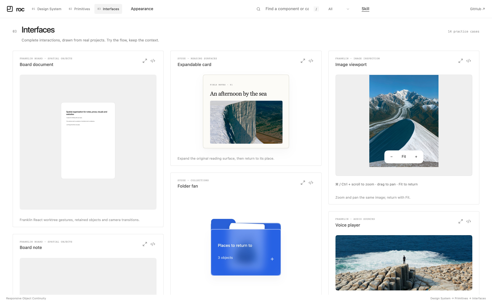

<h1 align="center">
  <a href="https://songhaifan.github.io/roc-ui/">
    <picture>
      <source media="(prefers-color-scheme: dark)" srcset=".github/brand/lockup-dark.svg" />
      
    </picture>
  </a>
</h1>

<p align="center"><b>让对象在变化中保持连续。</b></p>

<p align="center">
  <a href="https://songhaifan.github.io/roc-ui/">设计空间</a> ·
  <a href="https://songhaifan.github.io/roc-ui/skill.html">获取 skill</a> ·
  <a href="skills/responsive-object-continuity/SKILL.md">原则</a> ·
  <a href="CONSTITUTION.md">项目宪章</a> ·
  <a href="README.md">English</a>
</p>



ROC（Responsive Object Continuity，响应式对象连续性）是一套方法，加上一个可以动手操作的设计空间。它关注的是：布局变化时，界面里的对象依然可以辨认、可以触达、可以继续使用。

## 方法与实践

| 部分 | 作用 | 源码 |
| --- | --- | --- |
| ROC Skill | 给 agent 用的跨框架原则、诊断流程，以及有源码依据的案例 | [skills/responsive-object-continuity/](skills/responsive-object-continuity/) |
| 设计空间 | 可以操作的案例，遵循统一的视觉和交互标准 | [src/](src/) |
| 可复用源码 | 把案例带到其他项目里的组件和 registry 包 | [registry/roc/](registry/roc/) |

原则和它们的实现放在同一个仓库里，案例可以和它描述的行为一起演进。Skill 可以单独安装；阅读它不需要 React，也不需要 Gallery 的 npm 依赖。

能让体验更好的地方，ROC 直接使用现有的库。一个好用的分工是：Base UI 负责交互，Animate UI 负责动效，ROC 负责视觉、默认值和组合。产品和架构上的取舍记录在[项目宪章](CONSTITUTION.md)里。

## 安装 skill

从 [skill 页面](https://songhaifan.github.io/roc-ui/skill.html)下载独立的 ZIP，解压后把 `responsive-object-continuity` 文件夹放进你的 agent 支持的 skill 目录。

如果是本地 checkout，可以直接链接到源文件：

```sh
npm run skill:link
# 默认位置：~/.agents/skills/responsive-object-continuity

# 或者指定你的 agent 支持的位置：
npm run skill:link -- /path/to/agent/skills/responsive-object-continuity
```

这个命令只用 Node 自带的模块；如果目标位置已经有无关的内容，它不会动。链接后的 skill 始终读取这个 checkout 里的源文件。其他宿主可以直接复制 `skills/responsive-object-continuity/`。

可以这样对 agent 说：

> Use $responsive-object-continuity to make this card expand into its reader while preserving the editor, selection and return position. Verify opening, closing after scrolling, and interruption on desktop and mobile.

先读 [SKILL.md](skills/responsive-object-continuity/SKILL.md)，再读相关的案例。Skill 覆盖保留的对象与状态、安全区域、组合、导航、拖拽、联动投影、材质行为和返回时的交接。源码审查、历史测试和当前的视觉验收是三种不同的证据，分开记录。

## 浏览设计空间

Gallery 是一条连续的路径：**Design System → Primitives → Interfaces**。外观控件会实时更新各个案例。组件详情支持在桌面、平板、手机和中间宽度下单独查看；回到总览时，预览和它们的状态都会保留。

案例包括基础控件、阅读界面、集合、图片查看、音频、上下文编辑和素材托盘。Gallery 导入的就是它分发的那些文件；示例数据和 Gallery 自己的控件与可复用源码分开。

[设计 token 与边界](notes/design-system.md) · [React 约定](notes/react-design-system.md) · [目录覆盖](notes/catalog-coverage.md) · [实现边界](notes/primitives.md)

## 复用一个案例

在配置好 shadcn 的 React 项目里：

```sh
npx shadcn@latest add https://raw.githubusercontent.com/SonghaiFan/roc-ui/main/public/r/voice-player.json
```

把 `voice-player` 换成组件的 kebab-case 名称。需要 React 19 或更新版本，并支持 CSS 导入；每个包都声明了自己的依赖，并带上相关的源码、样式和许可证。

```tsx
import { VoicePlayer } from "./components/roc/voice-player";

<VoicePlayer src={recordingUrl} label="Recording" />
```

手动安装时，复制所选 `public/r/*.json` 包里列出的所有文件。可以通过 `className`、`style`、继承的 `--roc-*` token 或直接改源码来定制。替换共享文件时，保留你在本地做的修改。

## 开发与检查

```sh
npm ci
npm run dev
# http://127.0.0.1:4186

npm run check
npm run build
npm test
npm run test:consumer
```

`build` 生成 Gallery、registry 包、可下载的源码和独立的 skill 包。`docs/` 里的快照就是可部署的网站。`public/skills/` 和 `docs/skills/` 由 skill 源文件生成，要改请改 `skills/` 下的源文件。consumer 检查之后再跑一次 build，清掉它留下的临时浏览器测试文件，然后再发布。

只改 skill 时，`npm run check:skill` 会检查案例 ID、案例索引和打包的参考资料；`npm run package:skill` 重新生成独立文件，不需要安装 UI 依赖。改了某个案例的实现时，再跑相关的 Gallery 和浏览器检查。

## 许可

ROC 源码采用 [MIT](LICENSE) 许可，独立的 skill 包带有自己的许可证文件。引用的项目和打包的第三方实现保留各自的许可证和来源说明。Animate UI 是外部依赖，采用 [MIT + Commons Clause 许可](https://github.com/imskyleen/animate-ui/blob/main/packages/react/LICENSE.md)；registry 包里是 ROC 的适配层和依赖声明，没有复制 Animate UI 的源码。

<br />

<p align="center">
  <a href="https://leftopen.songhai.site"></a>&nbsp;
  <a href="https://github.com/SonghaiFan/token-flow"></a>&nbsp;
  <a href="https://songhaifan.github.io/roc-ui/"></a>
</p>

<p align="center"><sub>ROC 是 Franklin 系列的一部分。</sub></p>

<p align="right">
  <picture>
    <source media="(prefers-color-scheme: dark)" srcset=".github/brand/frank-signature-dark.svg" />
    
  </picture>
</p>
