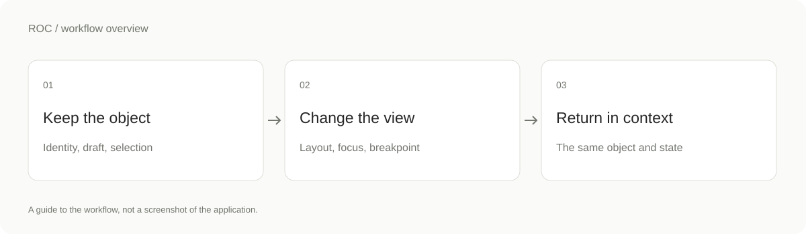

<h1 align="center">
  <picture>
    <source media="(prefers-color-scheme: dark)" srcset=".github/brand/lockup-dark.svg" />
    
  </picture>
</h1>

<p align="center"><b>同一个对象，穿过每一次变化。</b></p>

<p align="center"><a href="https://songhaifan.github.io/roc-ui/">设计空间</a> · <a href="https://songhaifan.github.io/roc-ui/skill.html">安装 Skill</a> · <a href="skills/responsive-object-continuity/SKILL.md">核心原则</a> · <a href="CONSTITUTION.md">项目宪法</a> · <a href="README.md">English</a></p>

<picture>
  <source media="(prefers-color-scheme: dark)" srcset=".github/brand/overview-dark.svg" />
  
</picture>

ROC 将 agent skill 与可操作的交互设计空间放在同一个项目中。方法说明如何保留对象身份、状态和上下文；Gallery 让这些原则可以实际体验；registry 用于把案例带入其他项目。

## 方法与实践

| 部分 | 用途 | 源码 |
| --- | --- | --- |
| ROC Skill | 跨框架原则、检查流程和案例 | [skills/responsive-object-continuity/](skills/responsive-object-continuity/) |
| 设计空间 | 使用共同视觉与交互规范的可操作案例 | [src/](src/) |
| 可复用源码 | 组件、样式与 registry | [registry/roc/](registry/roc/) |

项目目标是方法与实践案例，而不是自建所有底层组件。可使用 Base UI、Animate UI 和其他适合的库；取舍见 [项目宪法](CONSTITUTION.md)。Skill 可以独立安装，不依赖 Gallery 的 React 技术栈。

## 安装 Skill

从 [安装页](https://songhaifan.github.io/roc-ui/skill.html)下载 ZIP，解压后把 `responsive-object-continuity` 文件夹放入 agent 支持的 skill 目录。

本地源码可以直接链接：

```sh
npm run skill:link
# 默认 ~/.agents/skills/responsive-object-continuity
npm run skill:link -- /path/to/agent/skills/responsive-object-continuity
```

命令不覆盖已有的不相关目录。也可直接复制源码文件夹；Skill 的安装不需要安装 Gallery 的 npm 依赖。

示例请求：

> 使用 $responsive-object-continuity，让这张卡片展开成阅读器，同时保留编辑器、选区和返回位置。检查展开、滚动后收起，以及桌面和手机上的中途反转。

## 体验与复用案例

Gallery 按 **Design System → Primitives → Interfaces** 在同一页面展开。可调整外观、打开详情、切换预览宽度、查看源码；返回时保留案例状态。

已配置 shadcn 的 React 项目可安装某个案例：

```sh
npx shadcn@latest add https://raw.githubusercontent.com/SonghaiFan/roc-ui/main/public/r/voice-player.json
```

```tsx
import { VoicePlayer } from "./components/roc/voice-player";

<VoicePlayer src={recordingUrl} label="Recording" />;
```

需要 React 19+ 与 CSS 导入支持。每份 registry 声明自己的依赖、源码、样式与许可。手动接入时复制所选 `public/r/*.json` 中列出的全部文件。详见 [设计 tokens](notes/design-system.md)、[React 契约](notes/react-design-system.md)和 [实现边界](notes/primitives.md)。

## 开发与检查

```sh
npm ci
npm run dev
# http://127.0.0.1:4186
npm run check
npm run build
npm test
npm run test:consumer
```

`build` 生成 Gallery、registry、下载源码和独立 Skill 包；`docs/` 是可发布站点。`public/skills/` 与 `docs/skills/` 从 `skills/` 生成。消费者检查后再执行一次构建，移除临时预览 fixture。

只改 Skill 时可运行 `npm run check:skill` 与 `npm run package:skill`。实现变动另做对应交互验收；构建通过不代表所有浏览器和设备均已验收。

## 许可

ROC 源码采用 [MIT](LICENSE)，独立 Skill 包附带许可。依赖保留各自许可；Animate UI 是采用 [MIT + Commons Clause](https://github.com/imskyleen/animate-ui/blob/main/packages/react/LICENSE.md) 的外部依赖，registry 分发 ROC adapter 与依赖声明。

<br />

<!-- series-footer:start -->

<p align="center">
<a href="https://github.com/SonghaiFan/leftopen"></a>&nbsp;
  <a href="https://github.com/SonghaiFan/her-os"></a>&nbsp;
  <a href="https://github.com/SonghaiFan/roc-ui"></a>&nbsp;
  <a href="https://github.com/SonghaiFan/token-flow"></a>&nbsp;
  &nbsp;
  &nbsp;
  
</p>

<p align="center"><a href="https://github.com/SonghaiFan/rea">REA</a> · <a href="https://github.com/SonghaiFan/franklin-comments">Franklin Comments</a> · <a href="https://github.com/SonghaiFan/obsidian-blog-publisher">Obsidian Blog Publisher</a></p>

<p align="center"><sub>Franklin series · Made by <a href="https://github.com/SonghaiFan">Songhai Fan</a></sub></p>

<!-- series-footer:end -->

<p align="right">
  <picture>
    <source media="(prefers-color-scheme: dark)" srcset=".github/brand/frank-signature-dark.svg" />
    
  </picture>
</p>
